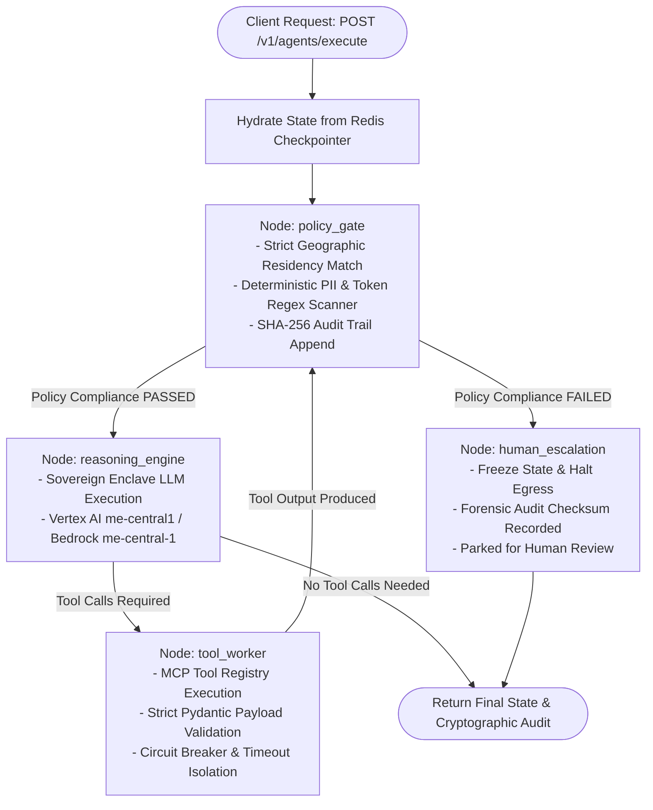

# sovereign-agent-runtime

[](https://github.com/umairqadir97/sovereign-agent-runtime/actions/workflows/ci.yml)
[](https://www.python.org/downloads/)
[](https://github.com/langchain-ai/langgraph)
[](https://opensource.org/licenses/Apache-2.0)
[](#sovereign-cloud--data-residency-architecture)

> **Enterprise-grade, sovereign multi-agent runtime engineered for strict geographic data residency, deterministic boundary governance, Model Context Protocol (MCP) tool isolation, and resilient LangGraph state persistence.**

---

## 1. Executive Summary & Problem Space

Enterprise multi-agent architectures running across regulated industries (defense, sovereign wealth funds, banking, telecommunications, and national health ministries) face stringent compliance mandates:
- **National Data Residency Laws** (e.g., Qatar National Cyber Security Agency [NCSA] Guidelines, UAE DESC, KSA NDMO, EU GDPR Article 44-50): Zero cross-border leakage of citizen PII or regulated corporate data beyond accredited hyperscaler sovereign regions (e.g., Google Cloud Doha `me-central1`, AWS UAE `me-central-1`).
- **Probabilistic Safety Fallacy**: Relying solely on system prompts or LLM "self-reflection" to enforce compliance fails against prompt injection, jailbreaks, and stochastic drift.
- **Workflow State Loss & Drift**: Distributed agent runs spanning long reasoning loops lose execution continuity across ephemeral pods unless backed by decoupled, encrypted persistence.

`sovereign-agent-runtime` addresses these challenges by introducing a **deterministic pre-call policy enforcement gate**, an **asynchronous Model Context Protocol (MCP) execution engine with per-tool circuit breakers**, and **durable LangGraph checkpointing** backed by Customer-Managed Encryption Keys (CMEK).

---

## 2. Architecture & Flow Diagram

The runtime structures execution into four isolated nodes with conditional edges governed by zero-trust policies:

```
                          ┌───────────────────────────┐
                          │   Incoming HTTP / SSE     │
                          │   POST /v1/agents/execute │
                          └─────────────┬─────────────┘
                                        │
                                        ▼
                          ┌───────────────────────────┐
                          │     [ policy_gate ]       │
                          │ Deterministic regex & PII │
                          │ Sovereign boundary check  │
                          └──────┬─────────────┬──────┘
                                 │             │
        Compliance PASSED        │             │ Policy FAILED
                                 ▼             ▼
  ┌──────────────────────────────────┐      ┌──────────────────────────────────┐
  │      [ reasoning_engine ]        │      │      [ human_escalation ]        │
  │ LLM reasoning in sovereign encl. │      │ Workflow halted; forensic audit  │
  └──────────────┬───────────────────┘      │ sealed; escalation ticket raised │
                 │                          └─────────────────┬────────────────┘
                 │ Tool Call Requested                        │
                 ▼                                            │
  ┌──────────────────────────────────┐                        │
  │        [ tool_worker ]           │                        │
  │ MCP tool registry invocation     │                        │
  │ Circuit breaker & Pydantic check │                        │
  └──────────────┬───────────────────┘                        │
                 │                                            │
                 └──────► (Loop back to policy_gate)          │
                                                              │
                                                              ▼
                                                   ┌─────────────────────┐
                                                   │       [ END ]       │
                                                   └─────────────────────┘
```

### Mermaid Flow Specification



---

## 3. Core Architectural Decisions

### A. Why Decoupled State Persistence Prevents Workflow Drift
In typical multi-step agent frameworks, conversation state and tool histories reside in process memory. Ephemeral container restarts, Kubernetes autoscaling eviction, or network timeouts lead to partial executions, lost context, or hallucinated re-starts (workflow drift).

`sovereign-agent-runtime` decouples execution from persistence:
1. **Durable LangGraph StateGraph**: Every node execution updates an immutable `AgentState` containing an append-only audit trail and `messages` managed by `add_messages` reducers.
2. **Encrypted Checkpointing (`AsyncRedisSaver`)**: Checkpoints are indexed by session thread ID and encrypted at rest with sovereign CMEK keys. If a worker pod fails mid-execution, any replacement pod instantly rehydrates the exact verified step with zero loss of execution continuity.
3. **Forensic Audit Hash-Chain**: Each transition calculates a deterministic SHA-256 checksum over the message payload and boundary parameters, preventing state tampering.

### B. Why Deterministic Pre-Call Gates Beat Probabilistic Safety
LLM-based guardrails (e.g. asking the LLM "is this response compliant?") introduce:
- **High latency overhead** (an extra round-trip to the model).
- **Vulnerability to jailbreaks and prompt injection**.
- **Stochastic uncertainty** (a 99% compliant prompt validator still leaks 1 in 100 requests).

Our architecture positions `policy_gate` as a **zero-trust deterministic filter**:
- **Zero-Latency In-Memory Analysis**: Compiles optimized regular expressions detecting National IDs (Qatar QID `23\d{10}`, UAE Emirates ID `784-XXXX-XXXXXXX-X`, Saudi Iqama), credit cards (validated with Luhn checksum algorithms), international bank account numbers (IBAN), and private keys.
- **Geographic Boundary Enforcement**: Rejects requests targeting unauthorized hyperscaler regions prior to LLM or network socket initialization.
- **Fail-Closed Escalation Routing**: Any violation immediately diverts control to `human_escalation`, completely bypassing LLM reasoning and third-party tools.

---

## 4. Sovereign Cloud & Data Residency Architecture

| Dimension | GCP Vertex AI Sovereign (`me-central1` Doha) | AWS Sovereign Cloud (`me-central-1` UAE) |
|---|---|---|
| **Data In-Country Boundary** | In-country data storage & model inferencing within Qatar National Cloud enclave | In-country residency within AWS Middle East UAE region |
| **Encryption at Rest** | Cloud KMS Customer-Managed Encryption Key (CMEK) | AWS KMS with dedicated CloudHSM Cluster |
| **Network Perimeter** | Google VPC Service Controls perimeter isolating APIs | AWS VPC Endpoints (PrivateLink) with strict egress security groups |
| **Access Governance** | Sovereign Controls partner access approval | Customer-controlled IAM enclave policies |

---

## 5. Repository Structure

```
sovereign-agent-runtime/
├── README.md                      # Executive architecture specification & Mermaid diagrams
├── pyproject.toml                 # Modern UV / Hatchling packaging & dependencies
├── Dockerfile                     # Hardened distroless multi-stage container
├── .github/workflows/ci.yml       # Automated linting, typing (mypy), and pytest
├── evals/                         # Tier 3 Red-Teaming & Evals Specification
│   └── promptfoo_eval.yaml        # Prompt injection & zero-egress benchmark
├── tests/                         # Multi-Tier Automated Test Suite (30 passed)
│   ├── conftest.py
│   ├── test_config.py
│   ├── test_graph.py
│   ├── test_graph_invariants.py   # Tier 2: State graph traversal & loop invariants
│   ├── test_policies.py
│   ├── test_server.py
│   ├── test_sovereign_boundaries.py # Tier 1: Deterministic DLP & residency gates
│   └── test_tools.py
└── src/
    └── runtime/
        ├── __init__.py            # Clean public API exports
        ├── config.py              # Pydantic Settings with VPC & CMEK env vars
        ├── state.py               # Durable AgentState TypedDict with audit traces
        ├── policies.py            # Deterministic guardrails & data residency checker
        ├── tools.py               # Standardized Model Context Protocol (MCP) client
        ├── graph.py               # LangGraph StateGraph with conditional edges
        └── server.py              # High-concurrency FastAPI endpoint with SSE streaming
```

---

## 6. The 3-Tier Enterprise Agent Testing Strategy

Testing agentic AI systems requires fundamentally rethinking conventional test patterns. Because agent workflows combine **probabilistic model outputs with stateful, multi-turn tool execution**, this repository adheres to a strict 3-tier testing pyramid:

```
                  Enterprise Agent Runtime Testing Pyramid
                       ┌───────────────────────┐
                       │   Tier 3: Evals &     │  Stochastic (Promptfoo / DeepEval,
                       │   Red-Teaming         │  Jailbreak, Hallucination, Zero-Egress)
                       ├───────────────────────┤
                       │  Tier 2: State Graph  │  Deterministic Graph Traversal
                       │  & Loop Invariants    │  (Cycles, Checkpoints, Recursion Limits)
                       ├───────────────────────┤
                       │ Tier 1: Boundary &    │  Deterministic DLP & Boundary Gates
                       │ Contract Enforcement  │  (PII Regex, Luhn Check, Residency Lock)
                       └───────────────────────┘
```

1. **Tier 1: Boundary & Sovereign Policy Testing (`tests/test_sovereign_boundaries.py`)**:
   - Deterministic verification ensuring zero cross-border leakage of sensitive tokens.
   - Pre-call gates block unapproved regions (e.g. `US-EAST`) and intercept unmasked PII (Qatar QID, UAE Emirates ID, PANs) before any LLM inference invocation.
2. **Tier 2: State Graph Traversal & Invariants (`tests/test_graph_invariants.py`)**:
   - Guarantees finite cycle termination and loop invariant integrity under recursion limits.
   - Validates that policy violations transition deterministically to `human_escalation`, never to `tool_worker`.
   - Confirms state persistence and rehydration over distributed Redis checkpointing.
3. **Tier 3: Evaluation Harness & Red-Teaming (`evals/promptfoo_eval.yaml`)**:
   - Automated benchmark specification defending against indirect prompt injection and egress bypass attempts.

---

## 7. Quickstart & Local Setup

### Prerequisites
- Python 3.11+ (Python 3.12 recommended)
- [uv](https://github.com/astral-sh/uv) (recommended) or standard `pip`
- Docker (for containerized execution)

### 1. Installation via `uv`

```bash
# Clone the repository
git clone https://github.com/umairqadir97/sovereign-agent-runtime.git
cd sovereign-agent-runtime

# Create isolated virtual environment and install dependencies
uv venv --python 3.12
source .venv/bin/activate
uv pip install -e ".[dev]"
```

### 2. Run Quality Checks & Tests

```bash
# Static analysis and linting
uv run ruff check .
uv run ruff format --check .

# Strict type checking
uv run mypy src

# Execute test suite
uv run pytest -v tests/
```

### 3. Launch Server Locally

```bash
uv run uvicorn runtime.server:app --host 0.0.0.0 --port 8000 --reload
```

---

## 8. API Usage Examples

### A. Health & Sovereign Readiness Check

```bash
curl -X GET http://localhost:8000/health/ready
```

**Response:**
```json
{
  "status": "ready",
  "service": "sovereign-agent-runtime",
  "environment": "production",
  "cloud_provider": "gcp_vertex",
  "cmek_key_configured": true,
  "vpc_perimeter_id": "accessPolicies/718293041/servicePerimeters/sovereign_perimeter_me_central1",
  "registered_mcp_tools_count": 2,
  "allowed_residency_regions": ["me-central1", "me-central-1", "me-central2", "eu-central-1", "isolated-enclave-01"]
}
```

### B. Compliant Sovereign Agent Execution

```bash
curl -X POST http://localhost:8000/v1/agents/execute \
  -H "Content-Type: application/json" \
  -d '{
    "prompt": "Summarize data sovereignty obligations under Qatar NCSA guidelines.",
    "data_residency_region": "me-central1",
    "tenant_id": "sovereign-bank-prod"
  }'
```

**Response:**
```json
{
  "session_id": "session-4a92f801b7a2",
  "tenant_id": "sovereign-bank-prod",
  "status": "success",
  "policy_compliance_passed": true,
  "data_residency_region": "me-central1",
  "output_message": "Execution verified within sovereign boundary [me-central1]. Query processed deterministically with zero data leakage.",
  "active_violations": [],
  "escalation_reason": null,
  "execution_audit_trail": [ ... ],
  "duration_ms": 14.85
}
```

### C. Deterministic Boundary Violation (Automatic Escalation)

```bash
curl -X POST http://localhost:8000/v1/agents/execute \
  -H "Content-Type: application/json" \
  -d '{
    "prompt": "Verify citizen account for Qatar ID 29801234567.",
    "data_residency_region": "me-central1"
  }'
```

**Response (Policy Enforced - Zero Model Invocation):**
```json
{
  "session_id": "session-7bc990234a1",
  "status": "escalated",
  "policy_compliance_passed": false,
  "data_residency_region": "me-central1",
  "output_message": "[SOVEREIGN GOVERNANCE HALT] Execution was blocked by sovereign security policy. Escalation Reason: Sovereignty boundary rejection: QATAR_NATIONAL_ID (count=1). Audit checksum verified. Session parked awaiting human supervisor review.",
  "active_violations": [
    "QATAR_NATIONAL_ID (count=1)"
  ],
  "escalation_reason": "Sovereignty boundary rejection: QATAR_NATIONAL_ID (count=1)"
}
```

### D. Server-Sent Events (SSE) Streaming

```bash
curl -N -X POST http://localhost:8000/v1/agents/execute \
  -H "Content-Type: application/json" \
  -d '{
    "prompt": "Tokenize citizen identity within enclave.",
    "data_residency_region": "me-central1",
    "stream": true
  }'
```

---

## 9. Production Containerization (Distroless)

Build and run the multi-stage, non-root Google Distroless container:

```bash
# Build the hardened image
docker build -t sovereign-agent-runtime:latest .

# Run container (non-root UID 65532, zero shell attack surface)
docker run -p 8000:8000 \
  -e SOVEREIGN_ENVIRONMENT=production \
  -e SOVEREIGN_DEFAULT_RESIDENCY_REGION=me-central1 \
  sovereign-agent-runtime:latest
```

---

## 10. License

Apache 2.0. Built for mission-critical enterprise autonomy and sovereign cloud governance.


